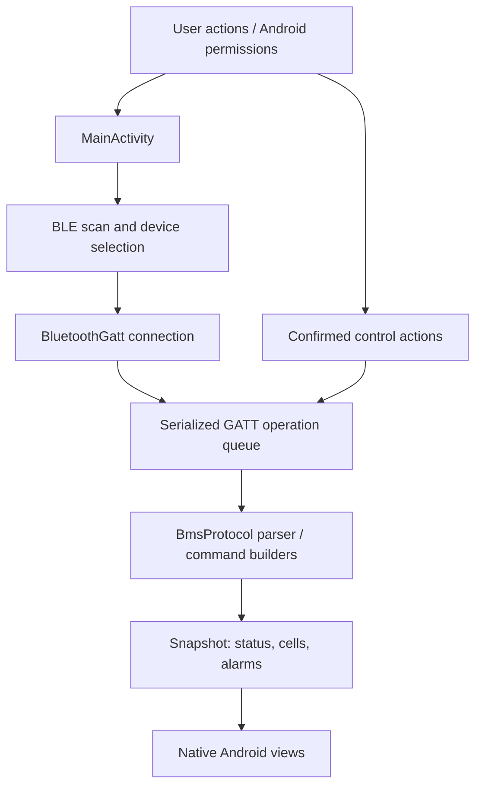

# Code walkthrough

This guide explains how the Haitai/Hinergi battery companion is put together and where to change it. The app is intentionally small: protocol logic is isolated in one Kotlin object; the native Android activity currently coordinates the UI and Bluetooth Low Energy (BLE) lifecycle.

> Compatibility is implementation-specific. The existence of a Haitai/Hinergi label does not prove that every pack, BMS board, or firmware revision uses the same BLE protocol. Confirm the exact hardware before relying on readings or controls.

## Architecture at a glance

`MainActivity` is an Android `Activity`. It creates the view tree in Kotlin, requests permissions, scans, connects, discovers the vendor service, schedules reads, serializes GATT operations, sends controls, and renders results. `BmsProtocol` is a pure Kotlin object for constants and byte-level transformations. Separating decoding from Android APIs makes its most important behavior testable on the JVM.

## Source map

| Path | Responsibility |
|---|---|
| `app/src/main/java/app/bmsmonitor/MainActivity.kt` | Screen construction, permissions, scanning, connection and GATT callbacks, queue and timeout handling, refresh loop, commands, diagnostics, and UI rendering. |
| `app/src/main/java/app/bmsmonitor/BmsProtocol.kt` | UUID constants, decoded data models, status/cell/alarm parsing, packet-to-snapshot assembly, command payloads, and hexadecimal formatting. |
| `app/src/test/java/app/bmsmonitor/BmsProtocolTest.kt` | JVM tests for protocol decoding and command payloads. |
| `app/src/main/AndroidManifest.xml` | App label/icon/theme, BLE hardware requirement, Bluetooth permission declarations, and launcher activity. |
| `app/src/main/res/` | App icon vector and style resources. |
| `app/build.gradle.kts` | Android SDK levels, application ID/version, Kotlin target, and JUnit dependency. |
| `build.gradle.kts`, `settings.gradle.kts`, `gradle.properties` | Gradle plugins/repositories, project identity, and build settings. |
| `gradle/wrapper/` | Gradle 8.7 wrapper configuration and wrapper JAR/script. |

The view hierarchy is built programmatically; there are no XML layout files. UI labels are in English, and the four bottom-navigation sections are Overview, Cells, Alarms, and Controls. The disconnected dashboard uses placeholders rather than fabricated readings. The app has no runtime library dependencies beyond the Android platform; JUnit is test-only.

## Startup and BLE connection

1. `onCreate()` obtains the Android Bluetooth adapter, builds the screen, initializes the disconnected UI, and renders empty data.
2. **Connect** calls `onConnectPressed()`. The app checks for a BLE adapter, the relevant Android-version permissions, and Bluetooth being enabled.
3. `beginScan()` starts a scan for up to eight seconds. `collectScanResult()` accepts a name beginning with `BTD` (case-insensitive) or a device advertising the expected `0x8900` service. Results are de-duplicated by Bluetooth address and shown live in a picker with actual signal strength; the user selects a result before connecting.
4. `connectToDevice()` opens a LE GATT connection. On success the callback enters service discovery.
5. `onServicesDiscovered()` requires the `0x8900` service. If it is absent, the app reports incompatibility and disconnects.
6. `enableAuthAndStart()` attempts to enable notifications on `0x8901` and write its optional Client Characteristic Configuration Descriptor, then queues the fixed 17-byte all-`FF` handshake. If auth or notification support is absent, it logs the condition and continues to reads. A failed handshake write also does not block monitoring.
7. `beginReadCycle()` queues reads for status, three cell blocks, and two fault blocks. Once they complete, the app assembles a `Snapshot`, updates the UI, and schedules the next cycle about 1.5 seconds later.
8. `onDestroy()` stops scanning, cancels scheduled callbacks, and disconnects/closes GATT. The explicit **Disconnect** button also clears queued work and resets displayed/command state.

## Why there is a GATT queue

Android GATT operations are asynchronous. Starting several reads/writes at once can cause callback ambiguity or failures on devices that expect only one active operation. `MainActivity` represents each task as a `GattOperation` and processes one at a time:

- `enqueue()` adds work to an `ArrayDeque`.
- `pumpQueue()` starts the next characteristic read, write, descriptor write, or local completion task.
- GATT callbacks call `completeOperation()` when the operation finishes.
- Each active BLE operation has a five-second timeout. A timeout is logged and the next operation may proceed.
- `closeGattQueue()` removes the timeout and queued tasks on disconnect.

The read-cycle's final local queue item creates the snapshot only after the requested reads have finished. A failed or missing characteristic is treated as absent data rather than as a fabricated measurement.

## Protocol decoder (`BmsProtocol.kt`)

The object provides:

- UUIDs for the vendor service and characteristics.
- `Status`, `Alarm`, and `Snapshot` data classes.
- `parseStatus()`, which requires at least 16 bytes and only interprets documented-by-code offsets 0–15.
- `parseCells()`, which ignores cell blocks shorter than 20 bytes and joins valid millivolt readings from up to three complete blocks.
- `parseAlarms()`, which maps configured bits and supplies a generic BMS fault when the status byte reports a fault but no detail bit was decoded.
- `snapshot()`, which combines packets and trims the cell list to the reported cell count when available.
- Direct command builders for charge MOS, discharge MOS / `SetPowerSwitch`, buzzer, and sleep using the payloads recovered from the original APK.

Battery on/off uses the original APK's direct `SetPowerSwitch` payload (`12 01 0B` / `12 01 0A`). The native power fallback list and cut-output sequence are not used. Each command shows its exact payload in a confirmation dialog; a successful GATT write is not physical-state readback. See the [protocol reference](PROTOCOL_REFERENCE.md) for the recovered mappings and limitations.

The names “documented-by-code” and “mapped” are deliberate: the current packet layout is not a substitute for vendor protocol documentation or a hardware validation record. In particular, trailing status bytes are ignored. Capacity remains unavailable rather than being guessed from offsets.

Detailed byte offsets, UUIDs, alarm bits, and exact command bytes are in the [BLE protocol reference](PROTOCOL_REFERENCE.md).

## Screen and controls (`MainActivity.kt`)

`buildUi()` creates a four-tab dashboard using the mockup's dark green/charcoal palette, rounded cards, restrained lime accents, and fixed bottom navigation. It creates cards for:

- Connection status, connect/refresh/disconnect actions, and an error panel.
- Animated horizontal wave battery bar for SOC, pack voltage/current, and operating state.
- A voltage history graph built from real readings collected in the current session. Dragging moves the inspection marker smoothly while the readout identifies the nearest real sample; 24-hour, 7-day, and 30-day controls animate the plotted shape between filtered views without inventing history or writing it to storage.
- SOH, cell count, temperatures, raw speed and raw BMS-status bytes, and explicit unavailable capacity placeholders.
- Per-cell voltage bars, highest/lowest values, the high-to-low difference labeled `Voltage (V)`, and a visual warning for a cell more than 100 mV from the pack average. This is a display heuristic, not a BMS alarm threshold.
- Charge MOS, discharge MOS, buzzer, battery on/off, and sleep actions using only the direct command payloads listed in the protocol reference.
- GATT diagnostic inspection, decoded protection alarms, a maximum-30-entry in-memory activity log, and a separate command log showing exact payloads and BLE write outcomes.

The control methods check that a BMS is connected. Each fixed command is routed through `confirmPowerAction()` so the user sees the exact payload and must explicitly continue. Power on/off sends one `SetPowerSwitch` payload; no fallback opcodes are attempted after a failed write.

For MOS switches, `commandStates` is a UI memory of the latest command whose BLE write callback reported success. It is reset on disconnect. It is **not** state read back from the battery. The app labels this caveat in the screen and log; do not change the wording to imply confirmed hardware state unless a validated readback protocol is implemented.

`scanGattServices()` displays discovered services and each characteristic's read/write/notify/indicate properties. It does not perform arbitrary command tests or accept raw user-supplied bytes.

The project includes JVM parser tests, but this walkthrough focuses on the app’s implementation; their existence does not establish behavior on a live battery. The project manifest declares no internet permission. Android 12+ needs `BLUETOOTH_SCAN` and `BLUETOOTH_CONNECT`; older supported Android versions use location permission for BLE discovery.

## Safe change checklist

When extending this project:

1. Keep packet parsing in `BmsProtocol`, not mixed into Android callbacks.
2. Add a unit test for every new field, scale factor, sentinel, alarm bit, and command payload.
3. Do not infer capacity or other fields from spare bytes without a traceable vendor definition and independent verification.
4. Treat power commands as hazardous. Keep explicit confirmation, do not add unverified fallback commands, and document that a successful write does not confirm the physical state.
5. Test read/write capability and callback behavior on the actual Android versions and target battery. A JVM test is not a radio test.
6. Keep captured BLE logs, uploaded diagnostic files, device addresses, and any personal/device identifiers out of version control. `.gitignore` excludes common BLE capture paths and extensions; verify staged files before committing.
7. Do not add a license or imply broad model support without the owner's decision and evidence.
